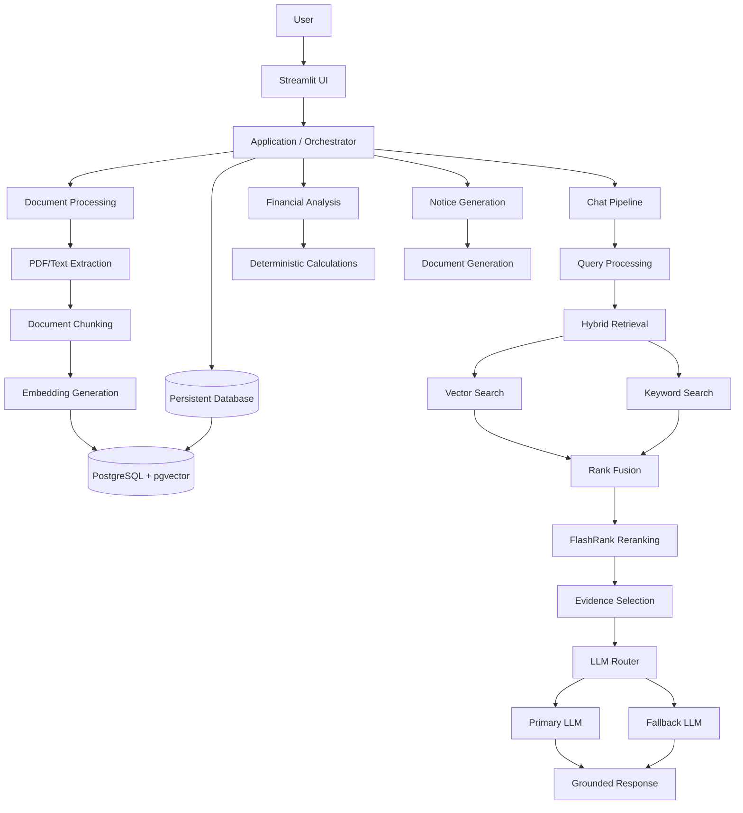

# LeaseLens

**AI-Powered Lease Analysis, Contract Intelligence & Tenant Assistance**

LeaseLens is an AI-powered application designed to help tenants understand rental agreements, identify important contractual obligations, analyze financial terms, detect potential risks, and make informed decisions through an interactive conversational interface.

Instead of manually reading lengthy lease agreements, users can upload their rental documents and ask natural-language questions about rent, security deposits, termination clauses, maintenance responsibilities, notice periods, deductions, and other contractual provisions.

LeaseLens combines **Retrieval-Augmented Generation (RAG), hybrid search, semantic reranking, deterministic financial calculations, document intelligence, and conversational AI** to provide evidence-grounded responses.

---

## Table of Contents

- [Overview](#overview)
- [Key Features](#key-features)
- [Architecture](#architecture)
- [System Workflow](#system-workflow)
- [AI and RAG Pipeline](#ai-and-rag-pipeline)
- [Hybrid Retrieval](#hybrid-retrieval)
- [Reranking](#reranking)
- [Conversational Intelligence](#conversational-intelligence)
- [Financial Analysis Engine](#financial-analysis-engine)
- [Security and Privacy](#security-and-privacy)
- [Technology Stack](#technology-stack)
- [Project Structure](#project-structure)
- [Installation](#installation)
- [Configuration](#configuration)
- [Running Locally](#running-locally)
- [How to Use](#how-to-use)
- [Example Queries](#example-queries)
- [Testing and Evaluation](#testing-and-evaluation)
- [Limitations](#limitations)
- [Future Improvements](#future-improvements)
- [Disclaimer](#disclaimer)

---

## Overview

Lease agreements often contain complex legal language, financial obligations, termination conditions, and clauses that are difficult for tenants to interpret.

LeaseLens addresses this problem by transforming lease documents into an interactive knowledge source.

Users can:

1. Upload a lease agreement.
2. Automatically extract and process document content.
3. Ask questions in natural language.
4. Retrieve relevant contractual provisions.
5. Receive contextual answers supported by document evidence.
6. Analyze rent, deposits, deductions, and financial obligations.
7. Generate lease-related notices and documents.
8. Maintain persistent conversations for future reference.

The system is designed to prioritize the contents of the uploaded agreement rather than generating answers from general-purpose AI knowledge alone.

---

## Key Features

### 📄 Intelligent Lease Document Processing

- Upload and process rental agreements.
- Extract textual content from documents.
- Divide documents into searchable chunks.
- Generate embeddings for semantic retrieval.
- Store document representations for future querying.

### 💬 AI-Powered Lease Chat

Ask questions about your lease using natural language.

Examples:

- What is my monthly rent?
- What is my notice period?
- Can my landlord deduct painting charges?
- Who is responsible for plumbing repairs?
- Can I leave before the lock-in period ends?
- What happens if I pay rent late?

The chatbot uses retrieved document evidence to formulate its responses.

### 🔍 Hybrid Retrieval System

LeaseLens combines multiple retrieval approaches to improve the relevance of retrieved contractual provisions.

- Semantic vector search
- Keyword-based retrieval
- Reciprocal Rank Fusion
- Semantic reranking

This helps retrieve relevant provisions even when users phrase questions differently from the language used in the lease.

### ⚖️ Contractual Risk Analysis

LeaseLens can analyze lease provisions to identify:

- Financial obligations
- Security deposit conditions
- Termination restrictions
- Lock-in periods
- Notice requirements
- Maintenance responsibilities
- Ambiguous clauses
- Missing contractual protections
- Potentially one-sided provisions

### 💰 Deterministic Financial Analysis

Financial calculations are performed using deterministic logic rather than relying entirely on LLM-generated arithmetic.

The system can analyze:

- Monthly rent
- Security deposit
- Total lease rent
- Deposit-to-rent ratio
- Potential deposit deductions
- Refund calculations
- Unpaid rent
- Utility obligations
- Notice-period rent implications

### 🧾 Security Deposit Audit

LeaseLens provides structured deposit analysis by considering:

- Original security deposit
- Monthly rent
- Documented deductions
- Unverified deduction claims
- Potentially refundable amount
- Deposit-related contractual conditions

### 📑 Notice Generation

The application supports lease-related notice generation based on the available contractual context.

Generated documents can incorporate:

- Relevant lease terms
- Tenant information
- Landlord information
- Notice requirements
- Requested action
- Relevant dates

### 🧠 Persistent Chat History

Conversations can be persisted so users can continue discussing their lease without losing previously established context.

### 🔄 LLM Routing and Fallback

The application incorporates an LLM routing mechanism with fallback handling to improve reliability when a model provider is unavailable or encounters an error.

### 🔌 MCP Integration

LeaseLens incorporates MCP-related functionality to support tool-based workflows and integrations.

---

# Architecture

LeaseLens follows a modular architecture separating document processing, retrieval, reasoning, financial analysis, persistence, and user interaction.



---

## Architecture Components

### 1. Frontend

The frontend is implemented using Streamlit.

Responsibilities:

- Document uploads
- Chat interface
- Lease analysis results
- Financial dashboards
- Security deposit analysis
- Document generation
- Conversation history

### 2. Application Orchestrator

The orchestrator coordinates the application workflow.

Responsibilities:

- Processing user requests
- Selecting the appropriate workflow
- Managing conversation context
- Calling retrieval services
- Invoking LLMs
- Handling tool calls
- Processing financial analysis requests
- Generating responses

### 3. Document Processing Layer

Responsible for converting uploaded documents into searchable representations.

Workflow:

```text
Document Upload
      ↓
Text Extraction
      ↓
Document Normalization
      ↓
Chunking
      ↓
Metadata Association
      ↓
Embedding Generation
      ↓
Database Storage
```

### 4. Retrieval Layer

Retrieves relevant contractual evidence using a combination of semantic and lexical retrieval.

### 5. Reasoning Layer

Uses retrieved evidence to generate contextual responses while applying contractual interpretation rules and evidence-grounding constraints.

### 6. Financial Engine

Performs deterministic calculations for financial information extracted from lease agreements.

### 7. Persistence Layer

Stores application data, document information, extracted content, embeddings, and conversational history.

---

# System Workflow

## Document Ingestion

When a user uploads a lease:

```text
Upload Lease
    ↓
Extract Text
    ↓
Normalize Content
    ↓
Split into Chunks
    ↓
Generate Embeddings
    ↓
Store Chunks + Metadata
    ↓
Store Vector Representations
```

Each document chunk can contain metadata such as:

- Document identifier
- Chunk identifier
- Page information
- Relevant metadata
- Extracted text
- Embedding representation

This metadata helps associate retrieved evidence with the original document.

---

## User Query Workflow

When a user asks a question:

```text
User Question
      ↓
Query Processing
      ↓
Hybrid Retrieval
      ↓
Candidate Evidence
      ↓
Rank Fusion
      ↓
Reranking
      ↓
Relevant Evidence Selection
      ↓
LLM Processing
      ↓
Grounded Response
```

The chatbot uses the retrieved contractual evidence to answer questions.

If sufficient evidence is unavailable, the system should avoid inventing contractual information.

---

# AI and RAG Pipeline

LeaseLens uses Retrieval-Augmented Generation to reduce unsupported responses.

Instead of asking an LLM to answer a lease question using its general knowledge, the system retrieves relevant provisions from the user's uploaded documents.

The retrieved content is supplied as contextual evidence to the language model.

## RAG Workflow

```text
Question
   ↓
Search Lease Documents
   ↓
Retrieve Relevant Chunks
   ↓
Rerank Candidates
   ↓
Select Evidence
   ↓
Construct Context
   ↓
LLM Generates Answer
   ↓
Response
```

### Why RAG?

RAG provides several advantages:

- Answers are grounded in uploaded documents.
- Users can query lengthy documents conversationally.
- Relevant clauses can be retrieved without sending the entire document to the model.
- Document-specific information can be accessed dynamically.
- Hallucination risk can be reduced.
- Context can be updated when documents change.

---

# Hybrid Retrieval

LeaseLens uses hybrid retrieval to combine semantic search and keyword-based search.

## Semantic Search

Semantic search retrieves content based on meaning rather than exact word matches.

For example:

**User query:**

> Can I leave my apartment before the agreement expires?

The system may retrieve clauses containing:

- Early termination
- Lock-in
- Notice period
- Vacating
- Termination conditions

Even if the exact words "leave my apartment" are not present.

## Keyword Retrieval

Keyword-based retrieval helps identify exact contractual terminology.

For example:

- Notice period
- Security deposit
- Lock-in
- Termination
- Rent
- Maintenance
- Clause numbers

## Reciprocal Rank Fusion

Hybrid results can be combined using Reciprocal Rank Fusion.

RRF helps combine the rankings generated by different retrieval methods.

Conceptually:

\[
RRF(d)=\sum_{r \in R}\frac{1}{k+rank_r(d)}
\]

Where:

- \(d\) = document chunk
- \(R\) = retrieval result sets
- \(rank_r(d)\) = ranking position of the chunk in retrieval system \(r\)
- \(k\) = ranking constant

This helps improve retrieval coverage by combining semantic and lexical relevance.

---

# Reranking

After hybrid retrieval, candidate chunks are reranked using FlashRank.

The retrieval stage identifies potentially relevant content.

The reranking stage evaluates which retrieved chunks are most relevant to the specific user question.

```text
Hybrid Search
     ↓
Candidate Chunks
     ↓
FlashRank
     ↓
Relevance Ranking
     ↓
Top Evidence
```

Reranking helps reduce irrelevant context and improve the quality of the evidence supplied to the LLM.

---

# Conversational Intelligence

LeaseLens supports conversational interactions rather than isolated questions.

For example:

```text
User:
What is my security deposit?

Assistant:
Your security deposit is ₹75,000.

User:
What happens if I leave early?

Assistant:
Your lease requires a notice period after the lock-in...

User:
Will that affect my refund?

Assistant:
The unserved notice period may affect your deposit...
```

The system uses conversational context to interpret follow-up questions.

This enables:

- Context retention
- Follow-up questions
- Multi-turn reasoning
- Conversational clarification
- Lease-specific discussions

---

# Evidence-Grounded Contract Interpretation

LeaseLens is designed to distinguish between different types of information.

### Explicitly stated

Information directly specified in the agreement.

Example:

> The lease states that the tenant must provide 60 days' written notice.

### Calculated

Information derived mathematically from supported inputs.

Example:

> Monthly rent × lease duration = total contractual rent.

### Inferred

A possible interpretation of contractual language.

Example:

> This clause may suggest that the landlord can recover certain costs from the security deposit.

### Not established

Information that cannot be conclusively determined from the available document.

Example:

> The lease does not explicitly establish whether pets are permitted.

This distinction helps reduce the risk of presenting interpretations as contractual facts.

---

# Financial Analysis Engine

LeaseLens uses deterministic financial calculations for supported financial workflows.

The LLM may extract or interpret contractual information, but calculations should be performed using application logic.

## Example Financial Analysis

```text
Monthly Rent: ₹30,000

Security Deposit: ₹150,000

Deposit-to-Rent Ratio:

₹150,000 ÷ ₹30,000 = 5 months
```

## Supported Financial Concepts

- Monthly rent
- Lease duration
- Total rent
- Security deposit
- Deposit ratio
- Unpaid rent
- Utility deductions
- Documented damage deductions
- Potential refund calculations

## Deposit Audit

A deposit audit can analyze:

```text
Original Security Deposit
        ↓
Unpaid Rent
        ↓
Unpaid Utilities
        ↓
Documented Damage
        ↓
Other Supported Deductions
        ↓
Potentially Refundable Amount
```

The system should distinguish between:

- Documented deductions
- Unverified deduction claims
- Contractually permitted deductions
- Potentially refundable balances

---

# Notice Generation

LeaseLens can assist with lease-related notice generation.

The generated notice may incorporate:

- Lease details
- Relevant contractual provisions
- Notice period
- Termination date
- Tenant details
- Landlord details
- Requested action
- Supporting context

Generated notices should be reviewed by the user before sending.

---

# Security and Privacy

LeaseLens processes sensitive documents containing personal and financial information.

The application is designed with data isolation and security considerations in mind.

### Tenant Isolation

Database operations should ensure users can access only their own documents and related information.

### Document Privacy

Uploaded leases may contain:

- Names
- Addresses
- Financial information
- Contact details
- Signature information

These documents should be treated as sensitive information.

### Authentication and Authorization

Access to application resources should be controlled through appropriate authentication and authorization mechanisms.

### Database Security

Sensitive database credentials should be stored in environment variables or secure configuration systems rather than committed to source control.

### API Keys

LLM provider API keys should never be committed to the repository.

Use environment variables or deployment secrets.

---

# Technology Stack

| Category | Technology |
|---|---|
| Frontend | Streamlit |
| Backend / Application Logic | Python |
| Database | PostgreSQL |
| Vector Database | pgvector |
| Retrieval | Hybrid Search |
| Search Ranking | Reciprocal Rank Fusion |
| Reranking | FlashRank |
| AI Architecture | Retrieval-Augmented Generation |
| LLM Integration | LLM Router with Fallback |
| Document Processing | PDF/Text Extraction |
| Embeddings | Embedding Models |
| Database Access | PostgreSQL Integration |
| Tool Integration | MCP |
| Persistence | PostgreSQL |
| Deployment | Hugging Face Spaces |

---

# Project Structure

The project follows a modular architecture.

```text
LeaseLens/
│
├── app.py
│
├── agent/
│   ├── orchestrator.py
│   ├── orchestrator_backup.py
│   └── ...
│
├── database/
│   ├── ...
│   └── ...
│
├── document_processing/
│   ├── ...
│   └── ...
│
├── retrieval/
│   ├── ...
│   └── ...
│
├── financial/
│   ├── ...
│   └── ...
│
├── notice/
│   ├── ...
│   └── ...
│
├── tests/
│   ├── chat_quality_eval.py
│   └── ...
│
├── requirements.txt
├── README.md
└── ...
```

> The structure above represents the major architectural components. Exact filenames and directories may vary depending on the current implementation.

---

# Installation

## Prerequisites

- Python 3.10+
- PostgreSQL
- PostgreSQL with pgvector support
- Git
- Required LLM API credentials

---

## Clone the Repository

```bash
git clone YOUR_REPOSITORY_URL
cd LeaseLens
```

---

## Create Virtual Environment

### macOS / Linux

```bash
python3 -m venv .venv
source .venv/bin/activate
```

### Windows

```bash
python -m venv .venv
.venv\Scripts\activate
```

---

## Install Dependencies

```bash
pip install -r requirements.txt
```

---

# Configuration

LeaseLens requires configuration for database access and AI services.

Use environment variables or your deployment platform's secret-management system.

Typical configuration categories include:

```env
DATABASE_URL=

LLM_API_KEY=

EMBEDDING_API_KEY=

MODEL_PROVIDER=

MODEL_NAME=
```

The exact environment variable names depend on the current implementation.

**Never commit API keys, passwords, tokens, or production credentials.**

For local development, use a `.env` file if supported by your configuration system.

Ensure `.env` is included in `.gitignore`.

---

# Database Setup

LeaseLens uses PostgreSQL with pgvector for storing application data and vector embeddings.

Ensure that:

1. PostgreSQL is running.
2. The required database exists.
3. pgvector is installed and enabled.
4. Database credentials are configured.
5. Required tables and indexes are initialized.

The application may initialize or validate its schema during startup depending on the implementation.

---

# Running Locally

Activate the virtual environment:

```bash
source .venv/bin/activate
```

Run the Streamlit application:

```bash
streamlit run app.py
```

The application will be available at the local Streamlit URL displayed in your terminal.

---

# How to Use

## 1. Upload a Lease

Upload your rental agreement through the application interface.

LeaseLens processes the document and prepares it for retrieval.

## 2. Ask Questions

Use the chat interface to ask questions about your lease.

Example:

```text
What is my monthly rent?
```

## 3. Analyze Contractual Terms

Ask questions about specific contractual obligations.

```text
Who is responsible for plumbing repairs?
```

## 4. Analyze Financial Obligations

```text
How much of my security deposit can be deducted?
```

## 5. Review Risks

```text
Identify the most important risks in my lease.
```

## 6. Generate Notices

Use the notice-generation workflow to prepare lease-related communications.

---

# Example Queries

### Basic Retrieval

```text
What is my monthly rent?
```

```text
How much security deposit did I pay?
```

```text
When does my lease expire?
```

### Contract Interpretation

```text
Can my landlord increase my rent during the lease period?
```

```text
Can I terminate my lease before it expires?
```

```text
Who is responsible for maintenance and repairs?
```

### Financial Reasoning

```text
How much money should I receive back when I move out?
```

```text
Calculate my total rent for the entire lease period.
```

```text
Can my landlord deduct painting charges?
```

### Hallucination Resistance

```text
Does my lease allow me to keep a pet?
```

```text
What is the penalty for paying rent late?
```

```text
Can my landlord enter my apartment without informing me?
```

### Context Retention

```text
What is my security deposit?
```

Follow-up:

```text
What happens if I leave early?
```

Follow-up:

```text
Will that affect my refund?
```

### Complex Reasoning

```text
Summarize the important financial obligations I have under this lease.
```

```text
Identify all termination provisions and any contradictions.
```

---

# Testing and Evaluation

LeaseLens includes testing workflows for evaluating chatbot quality.

Testing focuses on:

- Direct document retrieval
- Contract interpretation
- Financial reasoning
- Hallucination resistance
- Context retention
- Complex reasoning
- Contradiction detection

## Example Evaluation Categories

| Category | Objective |
|---|---|
| Direct Retrieval | Retrieve exact contractual information |
| Contract Interpretation | Interpret lease obligations |
| Financial Reasoning | Calculate financial outcomes |
| Hallucination Resistance | Avoid inventing missing provisions |
| Context Retention | Maintain conversational context |
| Complex Reasoning | Combine multiple clauses |
| Contradiction Detection | Identify conflicting provisions |

---

# Limitations

LeaseLens is an AI-assisted lease analysis application and is not a substitute for professional legal advice.

Potential limitations include:

- OCR and document extraction errors
- Incomplete retrieval
- Ambiguous contractual language
- Conflicting provisions
- Missing document information
- Jurisdiction-specific legal differences
- LLM interpretation errors
- External legal references requiring verification

The quality of the answer depends on the quality of the uploaded document, extraction, retrieval, and available evidence.

---

# Future Improvements

Potential areas for further development:

- Improved document extraction and OCR
- Retrieval quality evaluation
- Automated contradiction detection
- Clause-level document comparison
- Multi-document analysis
- Better jurisdiction detection
- Automated lease risk scoring
- Advanced deposit dispute analysis
- Improved legal-reference validation
- Automated regression testing
- Retrieval precision and recall benchmarking
- Performance optimization
- Improved document visualization
- Exportable lease reports
- Enhanced notice generation
- Tenant-specific document management

---

# Disclaimer

LeaseLens is an AI-powered document analysis tool intended to help users understand rental agreements and organize contractual information.

It does not provide formal legal advice, and its interpretations may not reflect the applicable law in every jurisdiction.

Users should independently verify important contractual interpretations and seek qualified legal advice when necessary.

---

## Built With

LeaseLens combines document intelligence, retrieval systems, conversational AI, and deterministic financial analysis to make rental agreements easier to understand.

**The goal is simple: transform complex lease documents into accessible, actionable information.**


