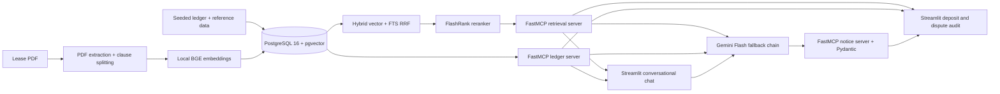

# LeaseLens

> **Demo video:** Record a 45-second walkthrough with macOS Screenshot (`Cmd + Shift + 5`) and add the resulting clip here before publishing.

LeaseLens is a local-first rental agreement and deposit dispute research demo. It indexes clauses from PDFs, retrieves lease and reference text with PostgreSQL full-text search plus pgvector, and reranks each corpus independently with FlashRank (up to two lease clauses and two statute references) so one corpus cannot crowd out the other. It exposes retrieval, deterministic ledger, and notice-drafting tools through FastMCP. Gemini calls try the stable Flash model chain `gemini-3.5-flash-lite`, `gemini-3.6-flash`, `gemini-3.7-flash`, then `gemini-3.8-flash`, moving to the next model after an API error and falling back to deterministic retrieval-grounded output if all attempts fail. The UI identifies the selected Gemini model or deterministic fallback below replies and notices.

## Architecture



The three FastMCP services run as local stdio subprocesses when clients connect. Text embeddings and reranking are local; Gemini notice generation requires an API key and network access.

## Quick start

Requirements: Docker Desktop, Python 3.11 or newer, and a Gemini API key for agent/notice generation.

```bash
cp .env.example .env   # edit .env and set GEMINI_API_KEY
python3 -m venv .venv
source .venv/bin/activate
pip install -r requirements.txt
docker compose up -d
python -m ingestion.ingest_data --seed
python -m eval.evaluate_rag
```

Run the agent with `python -m agent.orchestrator` or launch the UI with `streamlit run app.py`. The Streamlit workspace has two tabs:

- **💬 Chat with Your Lease PDF:** multi-turn, retrieval-grounded Q&A with starter questions for lock-in/notice, deposits, maintenance, and eviction; inline clause/page and statutory citations; expandable retrieved evidence; and legal notice generation from the chat. Messages and citations are stored in PostgreSQL by tenant and lease, so returning to a lease restores its conversation.

The chat composer accepts open-ended questions and PNG, JPEG, or WebP screenshots/photos (up to three images, 10 MB each). Attached images are sent to Gemini with that turn's question and retrieved lease evidence; only the attachment filename and type are saved with chat history, while image bytes are not retained. If Gemini is unavailable, the deterministic fallback states that it could not analyze the image. To chat about a new agreement, turn off **Use Rahul demo case** in the sidebar, enter tenant/lease IDs, upload the PDF, and click **Ingest PDF**; the newly ingested lease becomes active in chat.

- **⚖️ Full Deposit & Dispute Audit:** side-by-side lease/statute evidence, the deterministic SQL deposit audit, risk assessment, and downloadable text notice.

### React workspace

The React + TypeScript frontend and FastAPI bridge provide the dark glass workspace shown above while leaving the Streamlit app available. Install the Python requirements after activating `.venv`, then start the bridge and frontend in separate terminals:

```bash
# Terminal 1 — from the repository root
uvicorn api.server:app --reload --port 8000

# Terminal 2
cd frontend
npm install
npm run dev
```

Open `http://localhost:5173`. The Vite dev server proxies `/api` to FastAPI on port `8000`. The bridge provides health, lease listing and upload, persistent chat with screenshot attachments, retrieval comparison, deposit audit, and notice generation. The original Streamlit app remains available with `streamlit run app.py`.

### Try a custom PDF immediately

The repository includes a fictional two-page Bengaluru rental agreement at [`sample_docs/sample_bengaluru_lease.pdf`](sample_docs/sample_bengaluru_lease.pdf), covering rent, deposit, lock-in and notice, a painting deduction, and appliance maintenance. To regenerate it with the installed `pypdf` dependency, run:

```bash
python sample_docs/generate_sample_lease.py
```

In the app, turn off **Use Rahul demo case**, enter a new tenant and lease ID, set rent to `30000` and deposit to `150000`, upload the sample PDF, and click **Ingest PDF**. Then ask questions in the chat tab or use the audit tab. The equivalent CLI ingestion command is:

```bash
python -m ingestion.ingest_data --pdf sample_docs/sample_bengaluru_lease.pdf --tenant-id tenant_123 --lease-id lease_123 --rent 30000 --deposit 150000
```

### End-to-end verification

With Docker/PostgreSQL running and dependencies installed, execute the repeatable integration suite from the repository root:

```bash
python tests/run_full_verification.py
```

It checks schema/indexes, tenant isolation, hybrid citations, exact demo ledger math, sample PDF ingestion and three-turn chat, 404/503 model fallback order, notice schema, both Streamlit tab workflows and downloads, the multi-MCP CLI workflow, and the RAG benchmark. Temporary PDF test rows are removed even if an assertion fails. It writes the observed results to [`docs/TEST_REPORT.md`](docs/TEST_REPORT.md). With `GEMINI_API_KEY` configured, backend and UI interactions may exercise the live Gemini fallback chain; if all attempts fail, deterministic fallback is verified.

To specifically verify PostgreSQL-backed conversation persistence, follow-up query rewriting, and tenant-scoped chat isolation, run:

```bash
python tests/test_persistent_chat.py
```

To index another agreement:

```bash
python -m ingestion.ingest_data --pdf /path/to/agreement.pdf --tenant-id tenant_123 --lease-id lease_123
```

Supply rent and deposit together to create the deterministic ledger account for a newly ingested lease:

```bash
python -m ingestion.ingest_data --pdf /path/to/agreement.pdf --tenant-id tenant_123 --lease-id lease_123 --rent 30000 --deposit 150000
```

Compose starts the database as container `leaselens-db`, database `leaselens`, on host port 5433 (the host's 5432 is already used by Homebrew PostgreSQL 18). To inspect it, run `docker exec -it leaselens-db psql -U leaselens -d leaselens -c '\\dt'`.

## Evaluation

Run `python -m eval.evaluate_rag` after seeding to print the measured result from the current local corpus. The values below are the recorded run for the seeded sample corpus.

| Retrieval method | Context precision | Citation recall |
|---|---:|---:|
| Vector-only | 0.667 | 1.000 |
| Hybrid RRF + FlashRank | 0.625 | 0.938 |

Measured locally on 2026-11-18 with `python -m eval.evaluate_rag`: vector-only context precision **0.667** and citation recall **1.000**; hybrid RRF + FlashRank context precision **0.625** and citation recall **0.938**. The benchmark has eight manually labeled demo queries. These scores are specific to the seeded sample and are not evidence of production quality.

## Demo case

The seed account is `user_rahul` / `lease_001`: monthly rent ₹25,000, deposit ₹1,00,000, claims of ₹28,000 for blanket repainting and ₹6,500 for an aging geyser coil without receipt, and a ₹2,500 itemised deep-cleaning deduction with a receipt. The demo ledger calculation subtracts only deductions with a receipt reference, yielding an illustrative refundable balance of ₹97,500 before any additional facts or legal review.

## Legal scope

Model Tenancy Act, 2021 material and the two-month residential security-deposit figure in this demo are **illustrative reference data**, not a statement of the law applicable to every tenancy. Indian rent-control and tenancy rules vary by state and jurisdiction, including Karnataka and Maharashtra. Verify current local law, the agreement, and evidence with a qualified lawyer before acting on a notice or refund estimate. The software is an information and workflow demo, not legal advice.

## Known limits

- Clause extraction is regex-based and depends on text being extractable from the PDF; scanned documents need OCR.
- The evaluation set is small and synthetic. Record local results and hardware when reporting metrics.
- The current UI uses the seeded example for demo mode; uploaded documents require the database to be running.
- Gemini API availability and free-tier limits are governed by Google and can change; the app is not guaranteed to incur ₹0 in every usage pattern.
