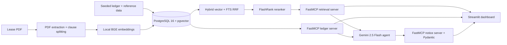

# LeaseLens

> **Demo video:** Record a 45-second walkthrough with macOS Screenshot (`Cmd + Shift + 5`) and add the resulting clip here before publishing.

LeaseLens is a local-first rental agreement and deposit dispute research demo. It indexes clauses from PDFs, retrieves lease and reference text with PostgreSQL full-text search plus pgvector, and reranks each corpus independently with FlashRank (up to two lease clauses and two statute references) so one corpus cannot crowd out the other. It exposes retrieval, deterministic ledger, and notice-drafting tools through FastMCP. Gemini notice drafting tries an ordered set of Flash models with bounded retries and falls back to a validated deterministic risk assessment and notice when the API is unavailable.

## Architecture



The three FastMCP services run as local stdio subprocesses when clients connect. Text embeddings and reranking are local; Gemini notice generation requires an API key and network access.

## Quick start

Requirements: Docker Desktop, Python 3.11 or newer, and a Gemini API key for agent/notice generation.

```bash
cp .env.example .env   # edit .env and set GEMINI_API_KEY
python3 -m venv .venv
source .venv/bin/activate
pip install -r requirements.txt
docker compose up -d
python -m ingestion.ingest_data --seed
python -m eval.evaluate_rag
```

Run the agent with `python -m agent.orchestrator` or launch the UI with `streamlit run app.py`. To index another agreement:

```bash
python -m ingestion.ingest_data --pdf /path/to/agreement.pdf --tenant-id tenant_123 --lease-id lease_123
```

Compose starts the database as container `leaselens-db`, database `leaselens`, on host port 5433 (the host's 5432 is already used by Homebrew PostgreSQL 18). To inspect it, run `docker exec -it leaselens-db psql -U leaselens -d leaselens -c '\\dt'`.

## Evaluation

Run `python -m eval.evaluate_rag` after seeding. The script prints the measured result from the current local corpus. No benchmark has been recorded in this repository yet; paste the output below after a successful run rather than reporting invented results.

| Retrieval method | Context precision | Citation recall |
|---|---:|---:|
| Vector-only | 0.667 | 1.000 |
| Hybrid RRF + FlashRank | 0.625 | 0.938 |

Measured locally on 2026-11-18 with `python -m eval.evaluate_rag`: vector-only context precision **0.667** and citation recall **1.000**; hybrid RRF + FlashRank context precision **0.625** and citation recall **0.938**. The benchmark has eight manually labeled demo queries. These scores are specific to the seeded sample and are not evidence of production quality.

## Demo case

The seed account is `user_rahul` / `lease_001`: monthly rent ₹25,000, deposit ₹1,00,000, claims of ₹28,000 for blanket repainting and ₹6,500 for an aging geyser coil without receipt, and a ₹2,500 itemised deep-cleaning deduction with a receipt. The demo ledger calculation subtracts only deductions with a receipt reference, yielding an illustrative refundable balance of ₹97,500 before any additional facts or legal review.

## Legal scope

Model Tenancy Act, 2021 material and the two-month residential security-deposit figure in this demo are **illustrative reference data**, not a statement of the law applicable to every tenancy. Indian rent-control and tenancy rules vary by state and jurisdiction, including Karnataka and Maharashtra. Verify current local law, the agreement, and evidence with a qualified lawyer before acting on a notice or refund estimate. The software is an information and workflow demo, not legal advice.

## Known limits

- Clause extraction is regex-based and depends on text being extractable from the PDF; scanned documents need OCR.
- The evaluation set is small and synthetic. Record local results and hardware when reporting metrics.
- The current UI uses the seeded example for demo mode; uploaded documents require the database to be running.
- Gemini API availability and free-tier limits are governed by Google and can change; the app is not guaranteed to incur ₹0 in every usage pattern.
